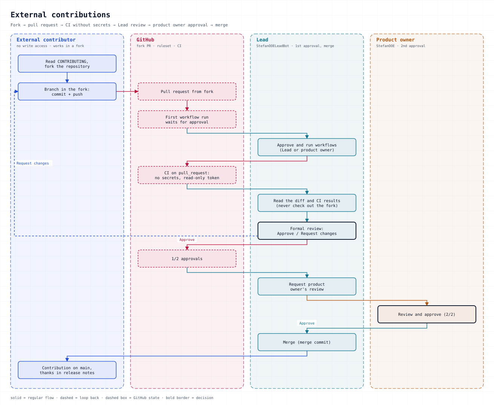

# Engineering Guidelines

These rules apply to every repository in the `StefanOOEOrg` organization — Python services, MCP
servers, and the Angular frontend alike. They are the single source of truth for code quality and
**supersede** any convention that a repository inherited from an earlier tool session or an earlier
project. When a repository disagrees with this document, the repository is wrong.

They address both audiences: people and coding agents. A rule that cannot be checked by a command,
a tool config, or a reviewer is written here as a rule but will not survive; prefer the mechanical
form.

Changes to this document go through a pull request here, like code.

How work is organised (roles, board, reviews): see [PROCESS.md](PROCESS.md).

---

## 1. Language

Code, identifiers, comments, docstrings, commit messages, pull-request and issue text, README and
every other document in a repository are written in **English**.

German is used in conversation only. German artifacts that already exist (for example an older
architecture document) are translated when the file is next touched, not in a mass rewrite.

## 2. Formatting and linting

**ruff** is the one and only Python linter and formatter. No second tool, no per-repo linter
preference.

```toml
# pyproject.toml
[tool.ruff]
line-length = 100

[tool.ruff.lint]
select = ["E", "F", "I", "UP", "B"]
```

- Gates: `ruff check .` and `ruff format --check .` — both must exit 0.
- Rules are not switched off globally and no rule is added to an ignore list. A single line that
  genuinely cannot comply gets an inline exception **with the reason**:
  `# noqa: E501  # long generated table name`.
- New dependencies for linting are limited to `ruff` itself.

## 3. Types

Every public function and method carries type hints on its signature — parameters and return value.
`Any` is a last resort and needs a comment explaining why the type is genuinely unknown.

No static type checker is a gate. Type hints are for readers and editors, not for a mypy run.

## 4. Structure and complexity

- Functions stay around **30 lines**. A file stays around **300 lines**. Both are smell thresholds,
  not laws: exceeding them is fine when the unit is genuinely one responsibility.
- Split **by responsibility**, never by line count. A file split "to get under the limit" produces
  two files with a fake boundary — split along the seam where the concepts actually differ, and say
  in the module docstring which concept went where.
- Prefer the simplest construct that works. No abstraction layers that only have one implementation
  and no prospect of a second.

## 5. Docstrings and comments

- Every module, class, and public function has a docstring.
- A function docstring states what it does, `Args`, `Returns`, and `Raises` — and, where it matters,
  *why* this shape was chosen over the obvious alternative.
- Comments explain **why**, never what the line already says.
- Incident history does not live in code. "Fixed on 2026-10-25 because X collapsed" belongs in
  `docs/`, with a pointer from the code at most.

## 6. Error handling

- No bare `except:` and no `except Exception: pass`.
- Each package defines its own exception class (for example `class ArgusError(Exception)`), raised
  with a message that names the offending value or path.
- Exactly one broad `except Exception` is allowed, and only at a system boundary (an MCP tool, a
  live loop, a CLI entry point) where it exists to convert *any* failure into a defined result —
  an error payload with `is_error: True`, a crash alert, an exit code. That handler carries a
  comment saying so.
- Never let a raw library exception reach the caller of a tool or API surface; wrap it in the
  package's own type with a message the user can act on.

## 7. Logging

- `logging`, never `print`. Repositories may wrap it (`get_logger(name)`); the wrapper stays thin.
- Lazy `%`-formatting — `logger.info("loaded model %s", version)`, not f-strings in log calls.
- INFO for state changes worth reconstructing a session from, WARNING for anomalies a human should
  see, ERROR for failures that end an operation.
- Never log secrets, tokens, or full payloads of personal data.

## 8. Configuration and secrets

- Configuration comes from the environment; secrets never appear in code, tests, issues, pull
  requests, commit messages, or logs.
- A repository ships `.env.example` with placeholder values; the real `.env` is gitignored.
- Defaults in code must be safe and machine-independent: `127.0.0.1`, never a private LAN address.
  Machine-specific values live in the untracked `.env`.
- A missing optional configuration file is a normal state (feature off, hint in the UI), not an
  error. A malformed one falls back to defaults **and** warns visibly.

## 9. Tests

- `pytest`. Tests are written **before** the implementation: a failing test that proves the gap,
  then the code that makes it pass.
- Test files mirror the package layout (`tests/<package>/test_<module>.py`).
- Unit tests run without network, GPU, or database. External systems are replaced by fakes,
  fixtures, or recorded payloads — a test that needs the internet is an integration test and is
  marked and run separately.
- No `skip` or `xfail` to get a suite green. A skipped test is a test that does not exist.
- Assertions check behaviour (return value, side effect, state), not that a call returned at all.

## 10. Coverage

CI enforces `--cov-fail-under=80`. A number in a Makefile that CI does not check is decoration.

Where 80 % is out of reach for a repository today, the gap is fixed or the repository's threshold is
raised explicitly in this document — never silently dropped in CI.

## 11. Dependencies

- Runtime and development dependencies are **pinned** (`==`). Lower bounds only cost a CI run and a
  debugging afternoon: an unpinned `torch` once pulled a 4 GB CUDA stack into a CPU-only test job
  and took the whole pipeline down.
- New dependency = a line in the pull request saying why the standard library or an existing
  dependency does not do the job.
- Development tooling is separated from runtime requirements.

## 12. Git, branches, reviews

- `main` is protected: changes arrive through a pull request, never by direct push, never forced.
- Branches: `wp/<issue>-<nn>-<slug>` for work packages, `docs/<issue>-<slug>` for documentation,
  `fix/<issue>-<slug>` for a standalone bug fix. Always branched from `upstream/main`.
- One logical change per commit. The message says what changed and why; format
  `<area>: <what> (<context>)`, with a body when the why is not obvious.
- Pull requests reference their issue (`Closes #n` or "Part of #n") and state how the change was
  verified.
- Merging is done by the repository owner, as a merge commit.
- A pull request that changes behaviour ships tests that fail without it.

## 13. Frontend (Angular / TypeScript)

- TypeScript `strict` mode; no `any`, no non-null assertion as a shortcut.
- ESLint and Prettier with the repository's committed config; both are CI gates.
- Component state via Signals where the framework offers them; no ad-hoc mutable service fields.
- Templates stay logic-free: no computation in the template that belongs in the component.

---

## Enforcement map

| Rule | Gate | Where |
|---|---|---|
| 2 Formatting/lint | `ruff check .`, `ruff format --check .` | CI + local (`make lint`) |
| 6 Error handling | review | PR review |
| 9 Tests | `pytest` | CI |
| 10 Coverage | `pytest --cov --cov-fail-under=80` | CI |
| 11 Dependencies | pinned files present | CI (install succeeds reproducibly) |
| 12 Branch protection | PR required, no force push, no deletion | organization ruleset |
| 13 Frontend | `tsc --noEmit`, `eslint`, `prettier --check`, `ng build` | CI |

## 14. Contributions from outside the organization

Inbound changes are accepted under the repository's license (MIT, see `LICENSE`). Opening a pull request is the
agreement: you confirm that you wrote the change or hold the rights to submit it, and you license it under the same
terms. No separate CLA document is required.

External pull requests arrive as forks, their first workflow run is approved by a maintainer, and they are reviewed
by a maintainer and merged by the repository owner (§12).

<picture>
  <source media="(prefers-color-scheme: dark)" srcset="https://github.com/StefanOOEOrg/.github/raw/main/assets/process-external-dark.svg">
  
</picture>

## Rollout

A repository adopts this document the next time it is touched in a way that already changes its
tooling; there is no big-bang migration across all repositories. The adoption is complete when the
enforcement map holds for that repository — ruff config present, CI gates green, dependencies
pinned, `.pylintrc` removed.

Repositories that still run `pylint` are not in violation while their migration is pending; they are
in violation the moment their linter is touched and left on the old stack.
