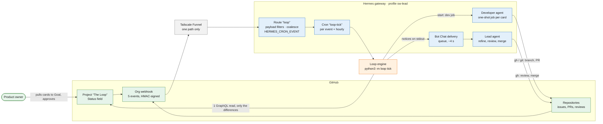
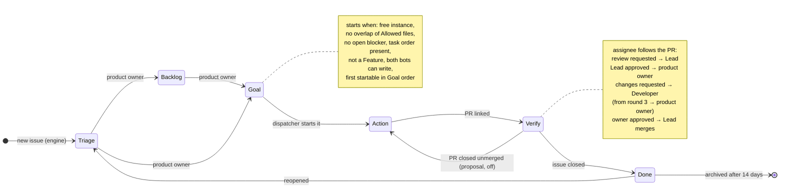

# .github

Organization-wide community health files for `StefanOOEOrg`.

- [`CONTRIBUTING.md`](CONTRIBUTING.md) — the engineering guidelines every repository in this
  organization follows. GitHub surfaces this file automatically when an issue or pull request is
  created in any repository of the organization that has no own `CONTRIBUTING.md`.
- [`PROCESS.md`](PROCESS.md) — how the organization develops software: roles, board, workflow and
  quality gates.
- [`LESSONS.md`](LESSONS.md) — every process correction with problem, cause, measure and status.
- [`profile/README.md`](profile/README.md) — the organization profile page, shown once this
  repository is public.
- [`assets/`](assets/) — the swimlane diagrams embedded in `PROCESS.md` and `CONTRIBUTING.md`;
  generated, not hand-edited.
- [`tools/`](tools/) — the automation that runs the process: the loop engine `tools/loop` and the
  diagram generators; `tools/install.sh` copies it into a Hermes profile.

Changes go through a pull request, like code.

## How The Loop runs

GitHub is the single source of truth. A GitHub event reaches the Hermes gateway through the org
webhook; the route filters it and fires the loop engine, which reads what the event concerns,
decides with fixed rules and writes only what differs. Agents do the work that needs judgement –
code, review, merge – and report back through GitHub. Colours: green GitHub, blue Hermes,
orange our code.

Every card follows one state machine. The engine evaluates it from the facts on each run (not from
the events), so a missed event is repaired by the next run; Backlog and Goal stay the product
owner's.

