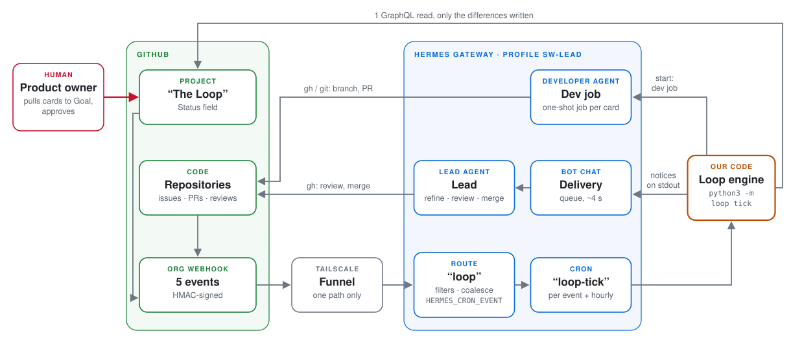
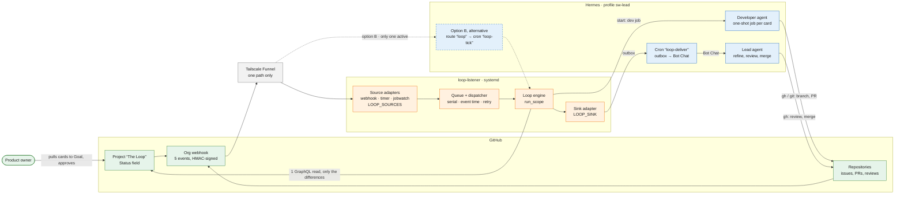
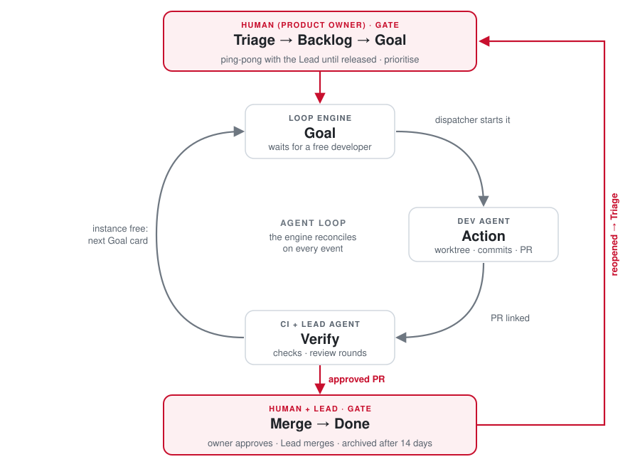
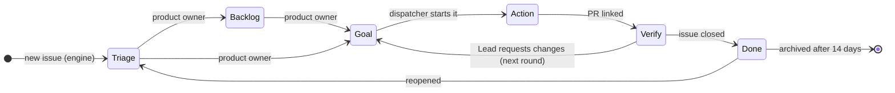

# .github

Organization-wide community health files for `StefanOOEOrg`.

## Why The Loop

This organization practises loop engineering: every task runs through the same loop on its own
instead of being planned into sprints. Scrum and similar processes were designed for teams of
humans – capacity, estimates, stand-ups; in an agentic team with a human reviewer the limit is the
human's attention at the gates, not the work in between.

The process lives in a script – deterministic, tested, traceable in its log – that decides every
transition on the board. Language models are used only where judgement is needed: writing and
reviewing code. The human sets the goals at the entry gate and approves at the exit gate.

## What is in this repository

Changes go through a pull request, like code.

- [`CONTRIBUTING.md`](CONTRIBUTING.md) — the engineering guidelines of every repository here;
  GitHub shows it for any repository of the organization without its own `CONTRIBUTING.md`.
- [`PROCESS.md`](PROCESS.md) — roles, board, workflow and quality gates.
- [`LESSONS.md`](LESSONS.md) — every process correction with problem, cause, measure and status.
- [`profile/README.md`](profile/README.md) — the organization profile page, shown once this
  repository is public.
- [`assets/`](assets/) — the generated swimlane diagrams of `PROCESS.md` and `CONTRIBUTING.md`.
- [`tools/`](tools/) — the automation: the loop engine `tools/loop`, the diagram generators and
  `tools/install.sh`, which copies it into a Hermes profile.

## How The Loop runs

GitHub is the single source of truth. An event reaches the loop listener through the org webhook;
the listener filters it and runs the loop engine, which reads what the event concerns, decides with
fixed rules and writes only what differs. Agents do the work that needs judgement – code, review,
merge – and report back through GitHub. (Alternatively the Hermes gateway route `loop` consumes the
webhook, the former setup; only one may be active: [*Consuming webhook signals: two
options*](tools/README.md#consuming-webhook-signals-two-options).) Colours: green GitHub, blue
Hermes, orange our code, red the human.

<picture>
  <source media="(prefers-color-scheme: dark)" srcset="docs/diagrams/architecture-dark.svg">
  
</picture>

Mermaid source

Every card follows one state machine, evaluated from the facts on each run rather than from the
events, so the next run repairs a missed event; Backlog and Goal stay the product owner's. Start
conditions, transitions and assignees: [PROCESS.md](PROCESS.md#project-workflows).

<picture>
  <source media="(prefers-color-scheme: dark)" srcset="docs/diagrams/loop-states-dark.svg">
  
</picture>

Mermaid source

