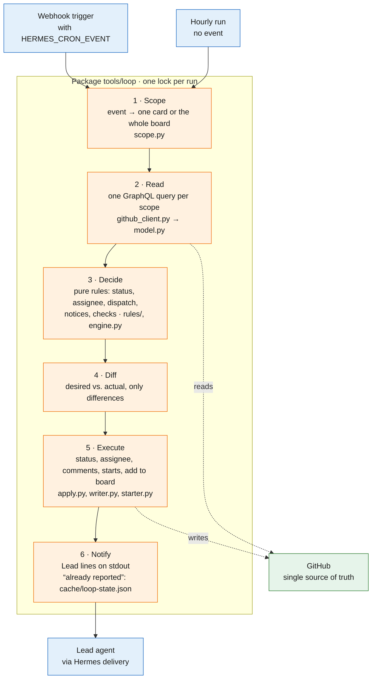
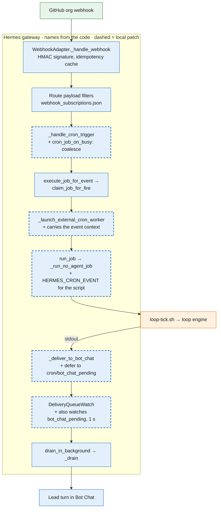

# tools/ – the automation of The Loop

What runs the process, kept here so that a change is reviewed like code. Why The Loop exists, its
architecture and the card states are in the [README](../README.md) and [PROCESS.md](../PROCESS.md).

| File | What it is |
|---|---|
| `loop/` | The loop engine, `python3 -m loop tick [--dry-run]`: reads what an event concerns (one card, or the whole board), decides with pure rules (`rules/`) and writes only the differences. Log `cache/loop.log`; local state `cache/loop-state.json` (what was already reported) and, after a failed run, the retry marker `cache/loop-retry.json`. Tests in `loop/tests/`. |
| `loop-tick.sh` | Runs the engine once. No-agent cron `loop-tick` of the `sw-lead` profile: on every webhook event (route `loop`, event in `HERMES_CRON_EVENT`) and hourly. |
| `loop-jobwatch.sh` | `python3 -m loop jobwatch`: a full engine run once a developer job has ended (its instance is free, but no GitHub event says so). No-agent cron `loop-jobwatch` of the `sw-lead` profile, every minute; silent and without GitHub calls while no job ended. It also retries a failed run (see below). |
| `install.sh` | Copies these files into `profiles/<profile>/scripts/`. Hermes only runs scripts from there, so the cron runs a copy: never edit it. Idempotent. |
| `review-pack.py` | `review-pack.py <owner/repo> <pr>`: the review pack for one PR (task, why, CI, earlier findings, round, scope drift, matching lessons). Read-only. |
| `gen-prozess-diagramm.py`, `gen-beitrag-diagramm.py`, `swimlane_svg.py` | Render the swimlanes in `assets/` (internal and external process). `gen-*.py [out_dir]`. |
| `ruff.toml` | Lint configuration. |

The old scripts `github-watch.sh`, `dev-dispatch.sh` and `assignee_sync.py`, replaced by the
engine, are in the git history up to commit `18f3b46`.

## The loop engine

One run of `python3 -m loop tick` (green GitHub, blue Hermes, orange our code):



The Hermes side, with the names from the Hermes code; dashed boxes are the local patch in
`hermes-config/patches` (async Bot Chat delivery, coalesce, event context for script jobs):



### A failed run

A run that fails – GitHub unreachable after the three gh attempts, the lock not free within
10 minutes, a crash – loses the event that fired it. It exits 1 as before and leaves
`cache/loop-retry.json` (first failure, last try, reason; `loop/retry.py`). The job watch, every
minute, runs the engine over the whole board once the last failure is `LOOP_RETRY_MINUTES` (3)
old, so a longer outage costs one try per 3 minutes, not three gh attempts per minute. A
successful full run – the retry, a job end or the hourly run – removes the marker; a one-card run
does not, as it may not cover the lost event. Silent unless the failure lasts
`LOOP_RETRY_REPORT_MINUTES` (30): then one notice to the Lead, and one when the runs work again.
That one notice exits 0, because Hermes delivers only a successful run's output to Bot Chat
(`--failure-deliver local`).

## Install, test, change

```bash
tools/install.sh                        # profile sw-lead; --profile <name>, --dry-run
cd tools && uvx --with pytest pytest -q  # tests (CI: also ruff, pylint, bash -n)
```

`HERMES_PROFILES_ROOT` overrides the profiles root (default `$HERMES_HOME/profiles`, else
`~/.hermes/profiles`; a `HERMES_HOME` pointing at a profile is refused).

After a merge that touches `tools/`: pause `loop-tick` (only while no developer job runs), run
`install.sh`, check with `python3 -m loop tick --dry-run` in the profile's `scripts/`, resume.
Change the files here, never the installed copy; no secrets, configuration comes from the
profile's environment. Every variable and its default is in `loop/config.py`; the one switch that
changes the state machine is `LOOP_VERIFY_BACK_TO_ACTION=1` – a Verify card goes back to Action
when its PR was closed without a merge. It is off (a proposal, not in use).

Every run logs one summary line, `run <event>: n status, n assignee, n close(s), n start(s), n
notice(s) printed`; it counts every kind of write, so a run that wrote something never reads like
a quiet one.
