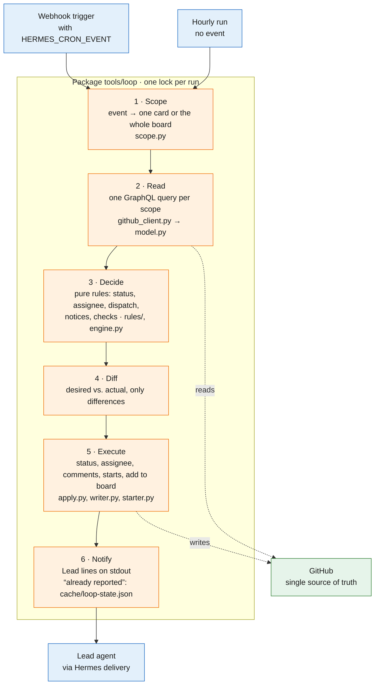
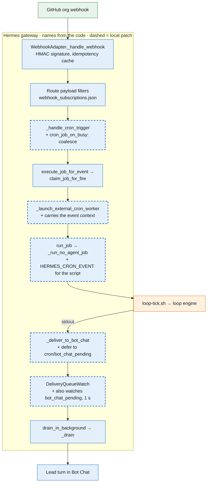
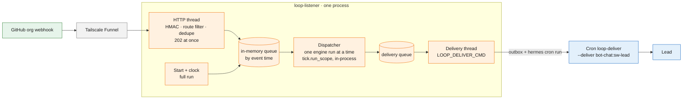

# tools/ – the automation of The Loop

What runs the process, kept here so that a change is reviewed like code. Why The Loop exists, its
architecture and the card states are in the [README](../README.md) and [PROCESS.md](../PROCESS.md).

| File | What it is |
|---|---|
| `loop/` | The loop engine, `python3 -m loop tick [--dry-run]`: reads what an event concerns (one card, or the whole board), decides with pure rules (`rules/`) and writes only the differences. Log `cache/loop.log`; local state `cache/loop-state.json` (what was already reported) and, after a failed run, the retry marker `cache/loop-retry.json`. Tests in `loop/tests/`. |
| `loop/listener.py`, `events.py`, `dispatcher.py`, `delivery.py`, `outbox.py`, `service.py` | The webhook listener, `python3 -m loop listen` (systemd `loop-listener`): receives the org webhook, queues it, runs the engine serially, delivers to the Lead asynchronously. See *The webhook listener* below. |
| `systemd/loop-listener.service`, `systemd/loop-listener.env.example` | Unit (user `hermes`, `Restart=always`) and its settings file. |
| `loop-deliver.sh` | `python3 -m loop outbox`: prints and empties the listener's outbox. No-agent cron `loop-deliver` of `sw-lead`, `--deliver bot-chat:sw-lead`, fired by the listener per message. |
| `loop-tick.sh` | Runs the engine once. No-agent cron `loop-tick` of the `sw-lead` profile; before the listener it ran on every event of the Hermes route `loop` (event in `HERMES_CRON_EVENT`) and hourly. Paused after the migration, see below. |
| `loop-jobwatch.sh` | `python3 -m loop jobwatch`: a full engine run once a developer job has ended (its instance is free, but no GitHub event says so). No-agent cron `loop-jobwatch` of the `sw-lead` profile, every minute; silent and without GitHub calls while no job ended. It also retries a failed run (see below). |
| `install.sh` | Copies these files into `profiles/<profile>/scripts/`. Hermes only runs scripts from there, so the cron runs a copy: never edit it. Idempotent. |
| `review-pack.py` | `review-pack.py <owner/repo> <pr>`: the review pack for one PR (task, why, CI, earlier findings, round, scope drift, matching lessons). Read-only. |
| `gen-prozess-diagramm.py`, `gen-beitrag-diagramm.py`, `swimlane_svg.py` | Render the swimlanes in `assets/` (internal and external process). `gen-*.py [out_dir]`. |
| `ruff.toml` | Lint configuration. |

The old scripts `github-watch.sh`, `dev-dispatch.sh` and `assignee_sync.py`, replaced by the
engine, are in the git history up to commit `18f3b46`.

## The loop engine

One run of `python3 -m loop tick` (green GitHub, blue Hermes, orange our code):



The Hermes side, with the names from the Hermes code; dashed boxes are the local patch in
`hermes-config/patches` (async Bot Chat delivery, coalesce, event context for script jobs):



### A failed run

This is about the cron runs (`loop-tick`, `loop-jobwatch`); the listener retries its own runs
itself (*The webhook listener*). A run that fails – GitHub unreachable after the three gh attempts, the lock not free within
10 minutes, a crash – loses the event that fired it. It exits 1 as before and leaves
`cache/loop-retry.json` (first failure, last try, reason; `loop/retry.py`). The job watch, every
minute, runs the engine over the whole board once the last failure is `LOOP_RETRY_MINUTES` (3)
old, so a longer outage costs one try per 3 minutes, not three gh attempts per minute. A
successful full run – the retry, a job end or the hourly run – removes the marker; a one-card run
does not, as it may not cover the lost event. Silent unless the failure lasts
`LOOP_RETRY_REPORT_MINUTES` (30): then one notice to the Lead, and one when the runs work again.
That one notice exits 0, because Hermes delivers only a successful run's output to Bot Chat
(`--failure-deliver local`).

## The webhook listener

Since 2026-11-10 the org webhook no longer goes through Hermes: a trigger of the Hermes route `loop`
could get lost while the cron `loop-tick` was busy (LESSONS.md). `python3 -m loop listen`, the
systemd service `loop-listener`, takes its place; no polling of GitHub.



**Receive** (`listener.py`, `events.py`). POST with `X-Hub-Signature-256` = HMAC-SHA256 of the body
under the secret (`LOOP_WEBHOOK_SECRET_FILE`), else 401. The filter of the former route: org
`StefanOOEOrg`; `issues` opened/edited/closed/reopened/assigned/unassigned/deleted/transferred,
`issue_comment` created, `pull_request` opened/edited/closed/reopened/ready_for_review/
converted_to_draft/review_requested/review_request_removed, `pull_request_review`
submitted/dismissed, `projects_v2_item` created/edited/deleted/archived/restored/converted, `ping`;
not the engine's own writes (sender `StefanOOELeadBot` and `projects_v2_item.edited`,
`issues.assigned/unassigned` or `issue_comment`), not a pull request from a fork. A dropped event is
answered 200 `ignored`, a known `X-GitHub-Delivery` 202 `duplicate`, an accepted one 202 `queued`.
The event time is the payload's own (`review.submitted_at`, `comment.updated_at`,
`projects_v2_item.updated_at`, `pull_request.updated_at`, `issue.updated_at`), else the receipt.
The signal JSON `{event, action, repo, issue, pr, item, sender}` is the one the route rendered into
`HERMES_CRON_EVENT`, so `scope.py` decides the scope unchanged.

**Run** (`dispatcher.py`). The dispatcher takes everything that waits, oldest event time first. One
event keeps its own scope (one card or the whole board); several become one full run.

**Guarantees.**

- *No accepted event is lost while the process runs:* an event leaves the queue only through a
  successful engine run that **started after it was queued**. A run reads GitHub after the change
  the webhook reports (GitHub sends it after the change), and a full run makes every decision a
  one-card run makes, so the merged run covers each event. Events arriving during a run wait for
  the next one.
- *Failure:* `GitHubError`, `TimeoutError` or `OSError` puts all events of the run back; the next
  try waits 5 s, doubled up to `LOOP_BACKOFF_MAX_SECONDS` (300). After 30 min of failures the Lead
  gets one notice, and one when it works again (`cache/loop-listener-retry.json`; the job watch's
  `cache/loop-retry.json` is for the cron runs only). Any other error ends the process; systemd
  restarts it after 10 s.
- *Restart, crash, shutdown:* the queue is in memory. Every start queues a full run first, which
  reads what happened meanwhile. SIGTERM stops accepting, makes one last run over what waits and
  logs the delivery IDs it could not run (`shutdown with n event(s) not run`); the start's full run
  covers them.
- *What it does not cover:* a delivery GitHub never made or gave up on (listener or Funnel down
  while GitHub sent – GitHub does not redeliver by itself). The start's full run and the clock's
  hourly full run (`LOOP_FULL_RUN_MINUTES`, 60) catch those, and redeliveries from the webhook page
  are safe (dedupe).
- *Order:* one engine run at a time in this process, in event-time order; the cron runs
  (`loop-jobwatch`, a manual `tick`) share the engine's file lock, so no two runs overlap.

**Deliver** (`delivery.py`, `outbox.py`). The dispatcher only queues the run's lines; one thread
hands each message to `LOOP_DELIVER_CMD` (no shell, message on stdin, exit 0 = accepted), in order,
retrying a failure with backoff. Messages still open at shutdown wait in
`cache/loop-deliver-pending.jsonl` and go first at the next start. Default command
`python3 -m loop deliver`: writes the message into `cache/outbox/` and runs `LOOP_OUTBOX_TRIGGER`
(default `hermes -p sw-lead cron run loop-deliver`); the no-agent cron `loop-deliver`
(`loop-deliver.sh`, `--deliver bot-chat:sw-lead`) prints and empties the outbox, and Hermes
delivers through its asynchronous Bot Chat lane. *Assumptions, to check on the TC:* `hermes send`
has no Bot Chat target (only Telegram is listed), so the cron job is the only scripted way into the
Lead's Bot Chat we know; `hermes cron run` takes the job **ID** and runs it "on the next scheduler
tick", which may add up to a tick of delay; a trigger refused while the job runs leaves the message
in the outbox for the next trigger or the job's 60-minute schedule.

**Settings** (`systemd/loop-listener.env.example`, every default in `loop/config.py`):
`LOOP_WEBHOOK_SECRET_FILE` (or `LOOP_WEBHOOK_SECRET`), `LOOP_LISTEN_HOST` 127.0.0.1,
`LOOP_LISTEN_PORT` 8655, `LOOP_LISTEN_PATH` (empty: any path), `LOOP_DELIVER_CMD`,
`LOOP_OUTBOX_TRIGGER`, `LOOP_FULL_RUN_MINUTES` 60, `LOOP_BACKOFF_MAX_SECONDS` 300.

### Migration on the TC

1. `tools/install.sh` (copies the listener, `loop-deliver.sh` and the unit into
   `profiles/sw-lead/scripts/`).
2. Secret: the org webhook's secret into `profiles/sw-lead/loop-webhook.secret` (mode 600,
   owner hermes; the same value the route `loop` uses today, or a new one set on GitHub as well);
   `systemd/loop-listener.env.example` → `profiles/sw-lead/loop-listener.env`.
3. Delivery job: `hermes -p sw-lead cron create 60m --name loop-deliver --script loop-deliver.sh
   --no-agent --deliver bot-chat:sw-lead --failure-deliver local`; put its ID into
   `LOOP_OUTBOX_TRIGGER=hermes -p sw-lead cron run <id>` in `loop-listener.env`. Test:
   `echo test | python3 -m loop deliver` in `scripts/` → the Lead gets "test".
4. As root: install the unit (header of `systemd/loop-listener.service`), `systemctl enable --now
   loop-listener`; `tail cache/loop.log` shows `listening on 127.0.0.1:8655` and the start's full run.
5. Funnel: point the webhook's public path at `http://127.0.0.1:8655` instead of the Hermes
   webhook port (`tailscale funnel status` shows the current mapping); then *Redeliver* a recent
   delivery on the org webhook page: 202 `queued` (or `duplicate`).
6. Switch off the Hermes route `loop` (remove it from `~/.hermes/webhook_subscriptions.json` or
   `hermes webhook` remove), so no event runs twice.
7. `loop-tick`: recommendation **pause it** (`hermes -p sw-lead cron pause <id>`), not delete, for a
   week, then remove. Its hourly run is replaced by the listener's clock, which runs in the same
   serial queue. That clock is not polling for changes – events come by webhook – but a timer for
   the time rules (D2 stuck after 15 min, W6 reminders, hourly repeats, archive after 14 days),
   which need a run even when nothing happens on GitHub; it also catches a webhook GitHub failed to
   deliver. Without any periodic run those rules fire only on the next event.
   `loop-jobwatch` stays: a developer job's end is not a GitHub event (local file, no GitHub call).

## Install, test, change

```bash
tools/install.sh                        # profile sw-lead; --profile <name>, --dry-run
cd tools && uvx --with pytest pytest -q  # tests (CI: also ruff, pylint, bash -n)
```

`HERMES_PROFILES_ROOT` overrides the profiles root (default `$HERMES_HOME/profiles`, else
`~/.hermes/profiles`; a `HERMES_HOME` pointing at a profile is refused).

After a merge that touches `tools/`: pause `loop-tick` (only while no developer job runs), run
`install.sh`, check with `python3 -m loop tick --dry-run` in the profile's `scripts/`, resume;
`sudo systemctl restart loop-listener` loads the new code into the listener (its start is a full run).
Change the files here, never the installed copy; no secrets, configuration comes from the
profile's environment. Every variable and its default is in `loop/config.py`; the one switch that
changes the state machine is `LOOP_VERIFY_BACK_TO_ACTION=1` – a Verify card goes back to Action
when its PR was closed without a merge. It is off (a proposal, not in use).

Every run logs one summary line, `run <event>: n status, n assignee, n close(s), n start(s), n
notice(s) printed`; it counts every kind of write, so a run that wrote something never reads like
a quiet one.
