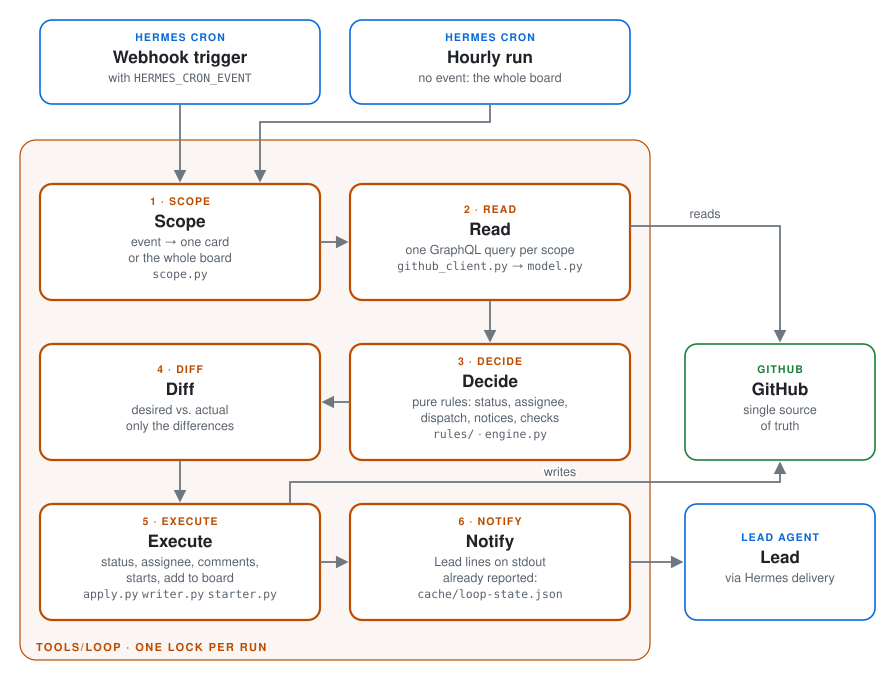
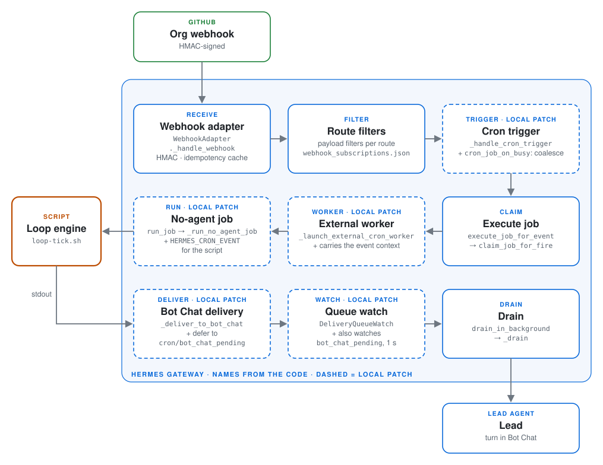
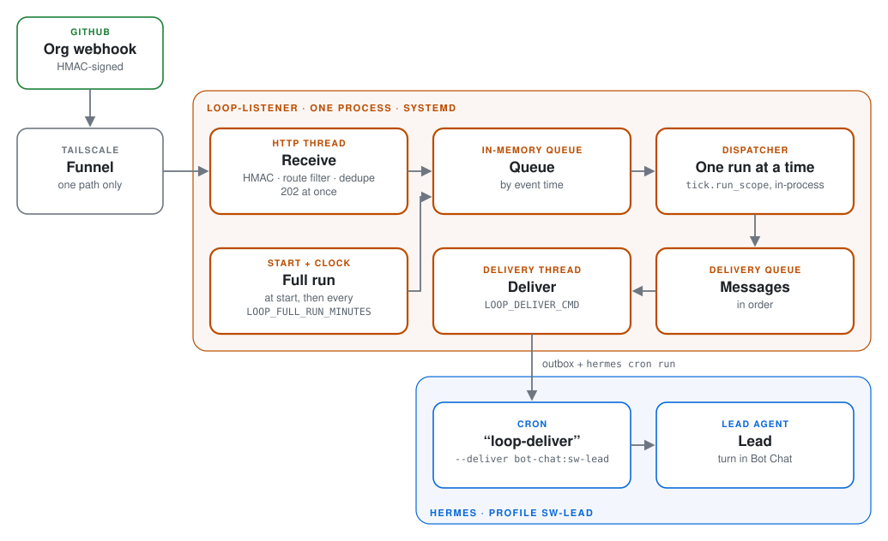
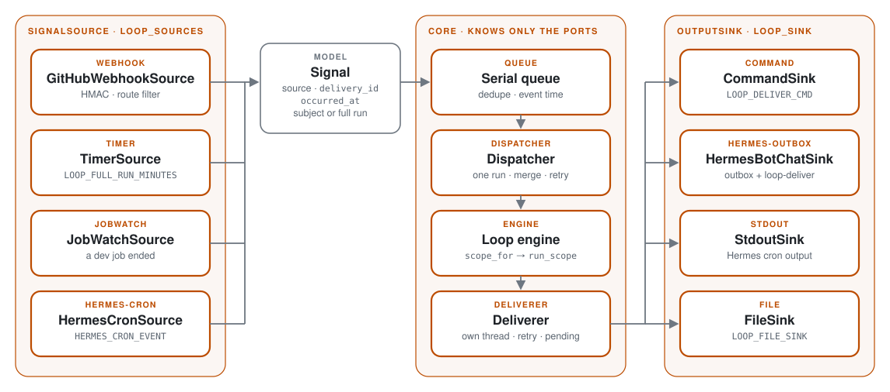
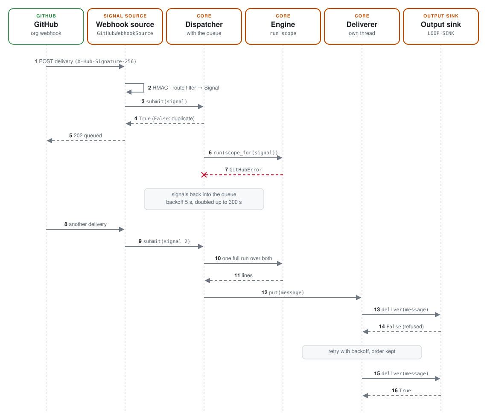

# tools/ – the automation of The Loop

What runs the process, kept here so a change is reviewed like code. Why, architecture and card
states: [README](../README.md), [PROCESS.md](../PROCESS.md).

| File | What it is |
|---|---|
| `loop/` | The loop engine, `python3 -m loop tick [--dry-run]`: reads what an event concerns (one card or the whole board), decides with pure rules (`rules/`), writes only the differences. Log `cache/loop.log`; state `cache/loop-state.json` (what was already reported); after a failed run the retry marker `cache/loop-retry.json`. Tests in `loop/tests/`. |
| `loop/listener.py`, `events.py`, `dispatcher.py`, `delivery.py`, `outbox.py`, `service.py` | The webhook listener, `python3 -m loop listen` (systemd `loop-listener`): receives the org webhook, queues it, runs the engine serially, delivers to the Lead asynchronously. See *The webhook listener* below. |
| `systemd/loop-listener.service`, `systemd/loop-listener.env.example` | Unit (user `hermes`, `Restart=always`) and its settings file. |
| `loop-deliver.sh` | `python3 -m loop outbox`: prints and empties the listener's outbox. No-agent cron `loop-deliver` of `sw-lead`, `--deliver bot-chat:sw-lead`, fired by the listener per message. |
| `loop-tick.sh` | Runs the engine once. No-agent cron `loop-tick` of `sw-lead`; before the listener it ran on every event of the Hermes route `loop` (event in `HERMES_CRON_EVENT`) and hourly. Paused since the migration. |
| `loop-jobwatch.sh` | `python3 -m loop jobwatch`: a full engine run once a developer job has ended (its instance is free, but no GitHub event says so). No-agent cron `loop-jobwatch` of `sw-lead`, every minute; silent and without GitHub calls while no job ended. Also retries a failed run (*A failed run*). |
| `install.sh` | Copies these files into `profiles/<profile>/scripts/`; Hermes only runs scripts from there, so the cron runs a copy – never edit it. Idempotent. Copies every `loop/**/*.py` (without `tests/`) by itself; other files are listed in its `FILES`. |
| `review-pack.py` | `review-pack.py <owner/repo> <pr>`: the review pack for one PR (task, why, CI, earlier findings, round, scope drift, matching lessons). Read-only. |
| `gen-prozess-diagramm.py`, `gen-beitrag-diagramm.py`, `swimlane_svg.py` | Render the swimlanes in `assets/` (internal and external process). `gen-*.py [out_dir]`. |
| `gen-tools-diagramme.py`, `readme_svg.py`, `readme_sequence.py` | Render this README's pictures into `docs/diagrams/tools-*-{light,dark}.svg` (style of the architecture picture). `gen-tools-diagramme.py [out_dir]`; `test_readme_diagrams.py` fails when a committed SVG differs from the generator. |
| `ruff.toml` | Lint configuration. |

The scripts the engine replaced (`github-watch.sh`, `dev-dispatch.sh`, `assignee_sync.py`) are in
the git history up to commit `18f3b46`.

## The loop engine

One run of `python3 -m loop tick` (green GitHub, blue Hermes, orange our code):

<picture>
  <source media="(prefers-color-scheme: dark)" srcset="../docs/diagrams/tools-engine-run-dark.svg">
  
</picture>

The Hermes side, named as in the Hermes code; dashed cards are the local patch in
`hermes-config/patches` (async Bot Chat delivery, coalesce, event context for script jobs):

<picture>
  <source media="(prefers-color-scheme: dark)" srcset="../docs/diagrams/tools-hermes-side-dark.svg">
  
</picture>

### A failed run

For the cron runs (`loop-tick`, `loop-jobwatch`); the listener retries its own runs (*The webhook
listener*). A failed run – GitHub unreachable after the three gh attempts, the lock not free within
10 minutes, a crash – loses the event that fired it. It exits 1 and leaves `cache/loop-retry.json`
(first failure, last try, reason; `loop/retry.py`). The job watch runs the engine over the whole
board once the last failure is `LOOP_RETRY_MINUTES` (3) old: one try per 3 minutes during an outage,
not three gh attempts per minute. A successful full run (the retry, a job end, the hourly run)
removes the marker; a one-card run does not, as it may not cover the lost event. Silent unless the
failure lasts `LOOP_RETRY_REPORT_MINUTES` (30): then one notice to the Lead, and one when runs work
again. That notice exits 0, because Hermes delivers only a successful run's output to Bot Chat
(`--failure-deliver local`).

## The webhook listener

Since 2026-11-10 the org webhook bypasses Hermes, whose route `loop` could lose a trigger while the
cron `loop-tick` was busy (LESSONS.md). The systemd service `loop-listener` (`python3 -m loop
listen`) takes its place; no polling of GitHub. Both ways compared:
*[Consuming webhook signals: two options](#consuming-webhook-signals-two-options)*.

<picture>
  <source media="(prefers-color-scheme: dark)" srcset="../docs/diagrams/tools-listener-dark.svg">
  
</picture>

**Receive** (`sources/github_webhook.py`, `listener.py`, `events.py`). POST with `X-Hub-Signature-256` = HMAC-SHA256 of the body
under the secret (`LOOP_WEBHOOK_SECRET_FILE`), else 401. The filter of the former route: org
`StefanOOEOrg`; `issues` opened/edited/closed/reopened/assigned/unassigned/deleted/transferred,
`issue_comment` created, `pull_request` opened/edited/closed/reopened/ready_for_review/
converted_to_draft/review_requested/review_request_removed, `pull_request_review`
submitted/dismissed, `projects_v2_item` created/edited/deleted/archived/restored/converted, `ping`;
not the engine's own writes (sender `StefanOOELeadBot` and `projects_v2_item.edited`,
`issues.assigned/unassigned` or `issue_comment`), not a pull request from a fork. A dropped event is
answered 200 `ignored`, a known `X-GitHub-Delivery` 202 `duplicate`, an accepted one 202 `queued`.
The event time is the payload's own (`review.submitted_at`, `comment.updated_at`,
`projects_v2_item.updated_at`, `pull_request.updated_at`, `issue.updated_at`), else the receipt.
The delivery becomes a `Signal` whose `Subject` holds the fields `{event, action, repo, issue, pr,
item, sender}` the route rendered into `HERMES_CRON_EVENT`, so `scope.py` decides the scope
unchanged (*Signal sources and sinks*).

**Run** (`dispatcher.py`). The dispatcher takes everything waiting, oldest event time first. One
event keeps its scope (one card or the whole board); several become one full run.

**Guarantees.**

- *No accepted event is lost while the process runs:* an event leaves the queue only through a
  successful engine run that **started after it was queued**. Such a run reads GitHub after the
  reported change (GitHub sends the webhook after it), and a full run makes every decision a
  one-card run makes, so the merged run covers each event. Events arriving during a run wait for
  the next.
- *Failure:* `GitHubError`, `TimeoutError` or `OSError` puts all events of the run back; the next
  try waits 5 s, doubled up to `LOOP_BACKOFF_MAX_SECONDS` (300). After 30 min of failures the Lead
  gets one notice, and one when it works again (`cache/loop-listener-retry.json`; the job watch's
  `cache/loop-retry.json` is for the cron runs only). Any other error ends the process; systemd
  restarts it after 10 s.
- *Restart, crash, shutdown:* the queue is in memory; every start queues a full run first, which
  reads what happened meanwhile. SIGTERM stops accepting, makes one last run over what waits and
  logs the delivery IDs it could not run (`shutdown with n event(s) not run`); the next start's
  full run covers them.
- *Not covered:* a delivery GitHub never made or gave up on (listener or Funnel down while GitHub
  sent – GitHub does not redeliver by itself). The start's full run and the clock's hourly full run
  (`LOOP_FULL_RUN_MINUTES`, 60) catch those; redeliveries from the webhook page are safe (dedupe).
- *Order:* one engine run at a time in this process, in event-time order; the cron runs
  (`loop-jobwatch`, a manual `tick`) share the engine's file lock, so no two runs overlap.

**Deliver** (`delivery.py`, `sinks.py`, `outbox.py`). The dispatcher only queues the run's lines;
one thread hands each message, in order, to the output sink (`LOOP_SINK`, default `command`:
`LOOP_DELIVER_CMD`, no shell, message on stdin, exit 0 = accepted) and retries failures with
backoff. Messages open at shutdown wait in `cache/loop-deliver-pending.jsonl` and go first at the
next start. Default command `python3 -m loop deliver`: writes the message into `cache/outbox/` and
runs `LOOP_OUTBOX_TRIGGER` (default `hermes -p sw-lead cron run loop-deliver`); the no-agent cron
`loop-deliver` (`loop-deliver.sh`, `--deliver bot-chat:sw-lead`) prints and empties the outbox, and
Hermes delivers through its asynchronous Bot Chat lane. *Assumptions, to check on the TC:*
`hermes send` has no Bot Chat target (only Telegram is listed), so the cron job is the only
scripted way into the Lead's Bot Chat we know; `hermes cron run` takes the job **ID** and runs it
"on the next scheduler tick" (up to a tick of delay); a trigger refused while the job runs leaves
the message in the outbox for the next trigger or the job's 60-minute schedule.

**Settings** (`systemd/loop-listener.env.example`, every default in `loop/config.py`):
`LOOP_WEBHOOK_SECRET_FILE` (or `LOOP_WEBHOOK_SECRET`), `LOOP_LISTEN_HOST` 127.0.0.1,
`LOOP_LISTEN_PORT` 8655, `LOOP_LISTEN_PATH` (empty: any path), `LOOP_DELIVER_CMD`,
`LOOP_OUTBOX_TRIGGER`, `LOOP_FULL_RUN_MINUTES` 60, `LOOP_BACKOFF_MAX_SECONDS` 300, `LOOP_SOURCES`
`webhook,timer`, `LOOP_SINK` `command` (next section).

### Migration on the TC

1. `tools/install.sh` (copies the listener, `loop-deliver.sh` and the unit into
   `profiles/sw-lead/scripts/`).
2. Secret: the org webhook's secret into `profiles/sw-lead/loop-webhook.secret` (mode 600,
   owner hermes; the same value the route `loop` uses today, or a new one set on GitHub as well);
   `systemd/loop-listener.env.example` → `profiles/sw-lead/loop-listener.env`.
3. Delivery job: `hermes -p sw-lead cron create 60m --name loop-deliver --script loop-deliver.sh
   --no-agent --deliver bot-chat:sw-lead --failure-deliver local`; put its ID into
   `LOOP_OUTBOX_TRIGGER=hermes -p sw-lead cron run <id>` in `loop-listener.env`. Test:
   `echo test | python3 -m loop deliver` in `scripts/` → the Lead gets "test".
4. As root: install the unit (header of `systemd/loop-listener.service`), `systemctl enable --now
   loop-listener`; `tail cache/loop.log` shows `listening on 127.0.0.1:8655` and the start's full run.
5. Funnel: point the webhook's public path at `http://127.0.0.1:8655` instead of the Hermes
   webhook port (`tailscale funnel status` shows the current mapping); then *Redeliver* a recent
   delivery on the org webhook page: 202 `queued` (or `duplicate`).
6. Switch off the Hermes route `loop` (remove it from `~/.hermes/webhook_subscriptions.json` or
   `hermes webhook` remove), so no event runs twice.
7. `loop-tick`: **pause it** (`hermes -p sw-lead cron pause <id>`) for a week, then remove it. The
   listener's clock, in the same serial queue, replaces its hourly run – not polling (events come
   by webhook) but a timer for the time rules (D2 stuck after 15 min, W6 reminders, hourly repeats,
   archive after 14 days), which otherwise fire only on the next event; it also catches a webhook
   GitHub failed to deliver. `loop-jobwatch` stays: a developer job's end is not a GitHub event
   (local file, no GitHub call).

## Consuming webhook signals: two options

Both ways start at the org webhook and Tailscale Funnel and end at the same engine (`tools/loop`)
and Lead; they differ in what receives the event and how the Lead's lines get out. **Option A,
directly through the loop listener, is the default and the recommendation;** option B, through the
Hermes gateway, was the setup until 2026-11-10 and remains a fallback. **Only one may be active:**
the Funnel has one target, and with both consuming every run happens twice.

<picture>
  <source media="(prefers-color-scheme: dark)" srcset="../docs/diagrams/tools-webhook-options-dark.svg">
  
</picture>

| | A · direct: `loop-listener` (default) | B · through Hermes: route `loop` + cron `loop-tick` |
|---|---|---|
| Path | Funnel → `GitHubWebhookSource` → serial queue + dispatcher → engine in-process → deliverer → sink `command` / `hermes-outbox` → cron `loop-deliver` → Bot Chat → Lead | Funnel → Hermes webhook adapter → route `loop` (filters, `cron_job_on_busy`: coalesce) → cron `loop-tick` (`HermesCronSource`, `HERMES_CRON_EVENT`) → engine → `StdoutSink` → Bot Chat → Lead |
| Reliability | No accepted event is lost while the process runs: queue, retry with backoff, a full run at every start; independent of a busy Hermes job; a slow Lead turn never holds up a run | A trigger that arrives while `loop-tick` runs is coalesced, its event lost until the next full run (hourly, or a job end); a failed run's event only through the job watch's retry (*A failed run*) |
| Operation | One more systemd service (`loop-listener`), its secret and env file; delivery still uses one Hermes cron (`loop-deliver`) | No own service, everything inside the Hermes gateway; needs the local Hermes patch (`hermes-config/patches`, *The Hermes side*) |
| Configuration | Funnel → `http://127.0.0.1:8655`; `LOOP_SOURCES` (default `webhook,timer`), `LOOP_SINK` (default `command`), `LOOP_DELIVER_CMD` / `LOOP_OUTBOX_TRIGGER`; route `loop` off, `loop-tick` paused | Funnel → the Hermes webhook port; route `loop` in `~/.hermes/webhook_subscriptions.json`; cron `loop-tick` active (per event + hourly), `LOOP_TICK_SINK` (default `stdout`); `loop-listener` stopped |
| Switching | B → A: the steps of *[Migration on the TC](#migration-on-the-tc)* | A → B: point the Funnel back at the Hermes webhook port, add the route `loop` again, resume the paused `loop-tick`, then `systemctl disable --now loop-listener` |

In both, `loop-jobwatch` stays and the engine is the same code with the same rules; only the
adapters differ (*[Signal sources and sinks](#signal-sources-and-sinks)*). Switch in the order
given, so that for a moment no consumer runs rather than two; the next full run catches an event
missed in between.

## Signal sources and sinks

The engine does not know where its signals come from or where its lines go. Two ports
(`loop/ports.py`, `typing.Protocol`, stdlib only) separate it from the outside; adapters fulfil
them, and one composition root (`loop/wiring.py`) picks them by configuration. Defaults: `listen`
with the webhook and the clock into `LOOP_DELIVER_CMD`; `tick` and `jobwatch` with
`HERMES_CRON_EVENT` onto stdout.

<picture>
  <source media="(prefers-color-scheme: dark)" srcset="../docs/diagrams/tools-ports-dark.svg">
  
</picture>

**The signal** (`loop/signals.py`). `Signal(source, delivery_id, occurred_at, subject)`; the
`Subject(kind, action, repo, issue, pr, item, sender)` is the change GitHub reported (the former
route JSON, `Subject.route_json()`), `subject=None` asks for a full run (`Signal.full`).
`scope.scope_for(signal)` maps it to the engine's scope; `scope_of(context)` still reads a route
JSON text.

**Sources** (`loop/sources/`, port `SignalSource`: `name`, `start(submit)`, `stop()`). `start`
returns at once: a waiting source runs its own daemon thread, a one-shot source submits before it
returns. After `stop` nothing is submitted.

| Name | Adapter | Signal |
|---|---|---|
| `webhook` | `GitHubWebhookSource` | one per accepted delivery (HMAC, route filter, 202 at once) |
| `timer` | `TimerSource` | a full run every `LOOP_FULL_RUN_MINUTES` (0: off) |
| `jobwatch` | `JobWatchSource` | a full run when a developer job ended, one look per `LOOP_JOBWATCH_SECONDS` (60); shares `cache/dev-jobs.json` with the cron `loop-jobwatch`, so a job end fires one run in whichever looks first |
| `hermes-cron` | `HermesCronSource` | the one signal of a cron run: `HERMES_CRON_EVENT`, else a full run |

Every source of `listen` feeds the same queue through `Dispatcher.submit`, so the guarantees above
hold for all: dedupe by `delivery_id`, event-time order, one run at a time, waiting signals merged
into one full run, a failed run keeps its signals and backs off, every start begins with a full run.

**Sinks** (`loop/sinks.py`, port `OutputSink`: `name`, `deliver(message) -> bool`,
`deliver_lines(lines)`; adapters derive from `BaseSink`). `deliver` is synchronous and returns
whether the message was accepted. In `listen` the `Deliverer` thread in front of the sink keeps a
slow sink from holding up a run, retries a refused message in order and keeps open messages across
a restart.

| Name | Adapter | Delivers |
|---|---|---|
| `command` | `CommandSink` | runs `LOOP_DELIVER_CMD` with the message on stdin, exit 0 = accepted (default of `listen`) |
| `hermes-outbox` | `HermesBotChatSink` | the same as the default command, in-process: `cache/outbox/` + `LOOP_OUTBOX_TRIGGER` → cron `loop-deliver` → Bot Chat |
| `stdout` | `StdoutSink` | prints; Hermes delivers a cron job's stdout (default of `tick`, `jobwatch`) |
| `file` | `FileSink` | appends to `LOOP_FILE_SINK` (default `cache/loop-out.txt`): tests, a trial run |

**Configuration** (`loop/config.py`, environment):

| Variable | Used by | Default |
|---|---|---|
| `LOOP_SOURCES` | `listen` | `webhook,timer` (comma-separated, any combination) |
| `LOOP_SINK` | `listen` | `command` |
| `LOOP_TICK_SINK` | `tick`, `jobwatch` | `stdout` |
| `LOOP_JOBWATCH_SECONDS` | source `jobwatch` | `60` |
| `LOOP_FILE_SINK` | sink `file` | `cache/loop-out.txt` |

An unknown name or an empty `LOOP_SOURCES` stops the start with an error rather than running
without a source or an output.

**A webhook event, end to end, with a failed run:**

<picture>
  <source media="(prefers-color-scheme: dark)" srcset="../docs/diagrams/tools-webhook-retry-dark.svg">
  
</picture>

**A new adapter.** Source: a class with `name`, `start(submit)` and `stop()` that calls
`submit(Signal(...))` with a unique `delivery_id` (a polling source derives from
`sources/polling.PollingSource` and implements `poll()`). Sink: a class derived from
`sinks.BaseSink` with `name` and `deliver(message) -> bool`. Then an entry in `SOURCES` or `SINKS`
of `wiring.py` (or `wiring.register_source` / `register_sink`), a contract test next to `tests/test_sources.py` or `tests/test_sinks.py`, and the
name in `LOOP_SOURCES` / `LOOP_SINK`. Engine, dispatcher and CLI stay unchanged.

## Install, test, change

```bash
tools/install.sh                        # profile sw-lead; --profile <name>, --dry-run
cd tools && uvx --with pytest pytest -q  # tests (CI: also ruff, pylint, bash -n)
```

`HERMES_PROFILES_ROOT` overrides the profiles root (default `$HERMES_HOME/profiles`, else
`~/.hermes/profiles`; a `HERMES_HOME` pointing at a profile is refused).

`install.sh` copies every Python module under `loop/` (recursively, without `tests/` and
`__pycache__`), so a new module needs no entry; the other files (shell scripts, systemd unit,
generators) stay listed in its `FILES`. An installed `loop/*.py` the source no longer has is
reported as `stale`, never deleted. `test_install.py` installs into a temporary profile and imports
every installed module, so CI fails before a merge can break the import on the TC.

After a merge that touches `tools/`: pause `loop-tick` (only while no developer job runs), run
`install.sh`, check with `python3 -m loop tick --dry-run` in the profile's `scripts/`, resume;
`sudo systemctl restart loop-listener` loads the new code into the listener (its start is a full
run). Change the files here, never the installed copy; no secrets – configuration comes from the
profile's environment, every variable and default is in `loop/config.py`. The one switch that
changes the state machine, `LOOP_VERIFY_BACK_TO_ACTION=1` (a Verify card goes back to Action when
its PR was closed without a merge), is off: a proposal, not in use.

Every run logs one summary line, `run <event>: n status, n assignee, n close(s), n start(s), n
failed start(s), n notice(s) printed`, counting every kind of write, so a run that wrote something
never looks quiet; `start(s)` counts only starts that worked. A failed start comments once (with
the marker `<!-- loop:start-failed -->`), goes to the Lead with a `Start fehlgeschlagen` line, and
is skipped while that comment is the card's latest change; the same run tries the next card.
