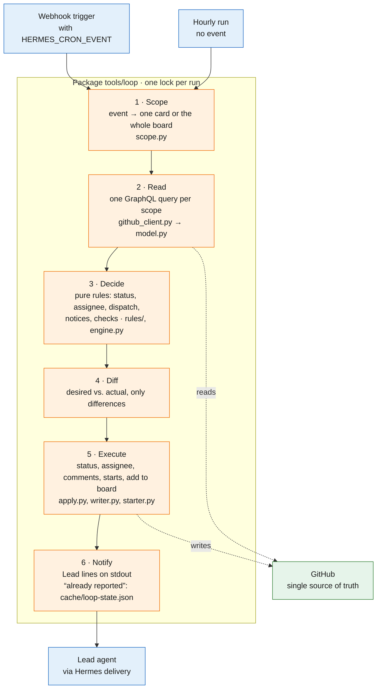
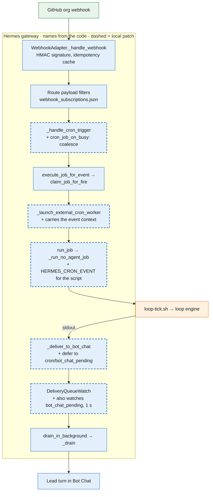

# tools/ — process automation

The automation that runs the team's process lives here, in the repository, so that a change to it is
reviewed like code and `git log` can answer why a rule exists. The cron jobs of the Lead
(`sw-lead` profile) do **not** run these files directly: Hermes refuses a script path that resolves
outside the profile's `scripts/` directory, so the installed copy must be a real file. That copy is
generated by [`install.sh`](install.sh) and is a copy — never edit it.

## The loop engine

One run of `python3 -m loop tick` (green GitHub, blue Hermes, orange our code):



The Hermes side, with the names from the Hermes code; dashed boxes are the local patch in
`hermes-config/patches` (async Bot Chat delivery, coalesce, event context for script jobs):



## What each script does

| File | Runs as | Does |
|---|---|---|
| `github-watch.sh` | no-agent cron, every 10 min, `--deliver bot-chat:sw-lead` | **Replaced by the engine, kept as the way back (crons paused).** Reports the Lead's inbox and what the assignee cannot show: stalled *Action* cards, *Verify* without a PR, PRs on Triage cards, PRs without a `Closes` line, issues missing from the project, merged `.github` PRs to review afterwards, the two-week retro. Writes the approve reminder on a PR. Keeps the snapshot in `profiles/<profile>/cache/`. Calls `assignee_sync.py` on every run. `WATCH_DRY_RUN=1` writes nothing to GitHub. The four GitHub reads run in parallel and the assignee sync alongside them (~3 s instead of ~6 s); `WATCH_DRY_RUN=1` now also runs the sync with `--dry-run`. |
| `dev-dispatch.sh` | no-agent cron, every 3 min, `--deliver local` | **Replaced by the engine, kept as the way back (crons paused).** Starts the first startable *Goal* card per free instance: sets instance, Developer and *Action*, prepares the worktree and starts the one-shot developer job. Skips cards with an open blocker or overlapping `Allowed files`; a blocker, a missing `Branch` / `Allowed files` line or a bot without write access gets one comment. A failed start puts the card back on Goal; an Action card without PR and developer job (`sw-developer/cron/jobs.json`) for 15 min goes to the product owner and frees its instance. `DISPATCH_DRY_RUN=1` changes nothing. |
| `loop/` | Python package, run by `loop-tick.sh` as `python3 -m loop tick` | The loop engine (design *Loop-Engine: Neudesign*): reads the scope with one GraphQL query (one card for a comment or a new issue, else the whole board), decides with pure rule functions (`rules/`: status incl. Verify/Done/archive, assignee, dispatch, checks, notices) and writes only the differences (`apply.py`, `writer.py`, `starter.py`). Lead notices on stdout; the only local state is `cache/loop-state.json` (what was already reported), seeded once from the old scripts' state files. `--dry-run` decides and logs, writes nothing. Log: `cache/loop.log`. |
| `loop-tick.sh` | no-agent cron `loop-tick`, every 60 min and on every webhook trigger, `--deliver bot-chat:sw-lead` | Runs the engine once. The Hermes route `loop` filters the GitHub events (org, relevant actions, no Lead-bot echo, no fork PR), passes the event as `HERMES_CRON_EVENT` and re-fires once if an event came in during a run (local Hermes patch, see `hermes-config/patches`). |
| `assignee_sync.py` | from `github-watch.sh` | **Replaced by the engine, kept as the way back (crons paused).** Keeps exactly one assignee per card: whoever acts next (PROCESS.md). Idempotent. |
| `review-pack.py` | manually, before a review | Prints the review pack for one PR (`review-pack.py <owner/repo> <pr>`): goal and acceptance criteria of the linked task, the parent feature as *why*, out of scope, CI, the findings of earlier rounds, the round number, the changed files outside the task's `Allowed files` and the matching `LESSONS.md` rows. Read-only: it only calls the `gh` API, so a fork PR is never checked out or run. |
| `gen-prozess-diagramm.py` | manually | Renders `assets/process-internal-{dark,light}.svg` (the swimlane in PROCESS.md). Usage: `gen-prozess-diagramm.py [out_dir]`. |
| `gen-beitrag-diagramm.py` | manually | Renders `assets/process-external-{dark,light}.svg`. Usage: `gen-beitrag-diagramm.py [out_dir]`. |
| `swimlane_svg.py` | imported by both generators | The renderer: lanes, nodes, edges and the two themes. Not run on its own. |

The directory is complete: everything the two generators need is here, so they run from a checkout
without any `PYTHONPATH` — Python puts the script's own directory on the path, so
`tools/gen-prozess-diagramm.py <out_dir>` works from the repository root.

## Installing into a profile

```bash
tools/install.sh                 # profile sw-lead, prints the target directory
tools/install.sh --profile sw-lead --dry-run
tools/install.sh <name>          # shorthand for --profile <name>
```

It copies the seven files into `profiles/<profile>/scripts/`, preserves their mode and verifies
each copy afterwards. It is idempotent: files that are already identical are reported as
`unchanged` and not rewritten, so a second run leaves the same bytes and prints the same target
directory.

Environment: `HERMES_PROFILES_ROOT` overrides the profiles root; otherwise the default is
`$HERMES_HOME/profiles` and, without `HERMES_HOME`, `~/.hermes/profiles` — a `HERMES_HOME` that points
at a profile directory (`…/profiles/<name>`) is refused, so pass `--profiles-root` there.

## Working on these scripts

- Change the file here, never the installed copy.
- One logical change per PR. This repository is the outer loop (PROCESS.md): changed directly, approved
  by the product owner, reviewed by the Lead after the merge.
- After a merge touching this directory, pause the crons, run `tools/install.sh`, resume and verify with
  `hermes cron run <job-id>` for the watch and the dispatcher.
- No secrets in the scripts; configuration comes from the profile's environment
  (`GH_PROJECT_NUMBER`, `DEV_INSTANCES`, …).
